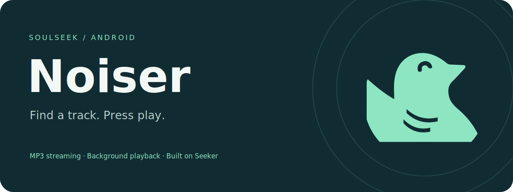
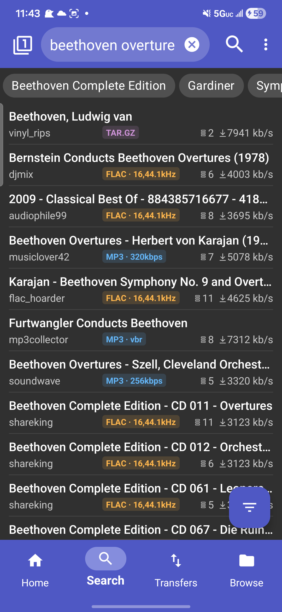
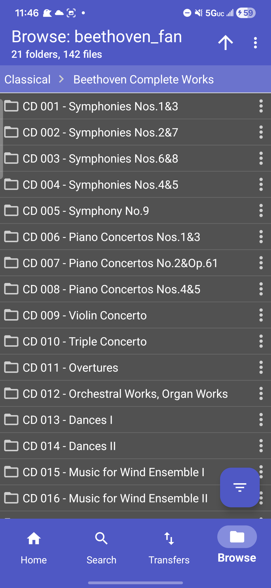
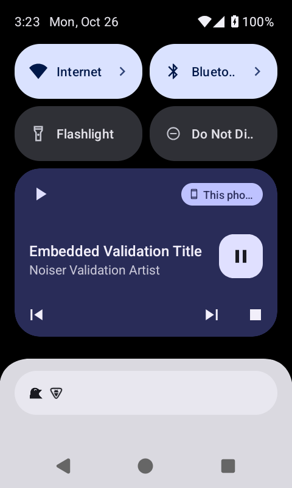

<p align="center">
  
</p>

<p align="center">
  <a href="https://github.com/miacadaver/Noiser/actions/workflows/android.yml"></a>
  <a href="https://github.com/miacadaver/Noiser/actions/workflows/unittests.yml"></a>
  
</p>

**A Soulseek client for Android that lets you play MP3s while they download.**

Noiser builds on [Seeker](https://github.com/jackBonadies/SeekerAndroid), keeping its search, sharing, downloads, and community features while adding an integrated player. Find a track, tap **Play**, and keep listening with the app in the background.

[Get the APK](#get-noiser) · [See it in action](#a-look-inside) · [Compare with Seeker](#noiser-and-seeker) · [Roadmap](ROADMAP.md)

## Listen as you discover

- **Play from search or Browse.** Start an MP3 without waiting for the entire file to download.
- **Keep listening.** A mini-player, Android media notification, lock-screen controls, and headset play/pause share one playback session.
- **Build a listening queue.** Folder queues, Play next, Add to queue, Next/Previous, repeat, and autoplay.
- **Return to your queue.** Reopen with the remembered song paused and an offline folder preview. Press Play to start from the beginning—no automatic playback. [Recovery details →](docs/queue-recovery.md)
- **See the track behind the filename.** Embedded title, artist, album, and artwork when available; conservative title/artist fallbacks when tags are missing.
- **A matching Noiser Mint interface.** Dark teal chrome with coordinated light, dark, and AMOLED themes. [Theme details and selection →](docs/ui-theme.md)
- **Keep the Soulseek essentials.** Search filters and wishlists, peer folders, downloads and uploads, messages, chatrooms, and UPnP port forwarding.

## A look inside

<table>
  <tr>
    <th>Find music</th>
    <th>Browse a peer</th>
    <th>Keep listening</th>
  </tr>
  <tr>
    <td align="center"></td>
    <td align="center"></td>
    <td align="center"></td>
  </tr>
</table>

Search and Browse screenshots are inherited from upstream Seeker and show the shared interface before Noiser's Play buttons and branding. The media card is an actual Noiser Android 15 emulator capture using generated test audio. These images predate the mint bird icon and Noiser Mint interface; they are not screenshots of the new build. [Playback validation and its limits →](docs/validation/2026-10-26-emulator.md)

## Get Noiser

1. Open [Android APK builds](https://github.com/miacadaver/Noiser/actions/workflows/android.yml) and choose the latest successful run on `main`.
2. Download **Noiser-apk** from **Artifacts** and extract **Noiser.apk**. Downloading Actions artifacts requires a GitHub account; artifacts expire after 14 days.
3. Install the APK on Android 6.0 or newer, allow installation from your browser/file manager if prompted, then sign in to Soulseek.
4. Open a peer folder or the track list from a search result and tap **Play** beside an MP3.

The app appears as **Noiser**. Version **3.11.2-stream.11** keeps the working package ID `com.companyname.andriodapp1.rollback`, separate from upstream Seeker and the earlier original-package builds. Renaming the app does not migrate or clear settings. Updating an existing installation also requires a matching signing certificate; Main-branch CI APKs reuse a pinned development signing certificate; validation APKs from pull requests use disposable keys. See [development signing](docs/development-signing.md) for the one-time transition from older builds and key-backup instructions.

This is an **experimental development build**, not a Play Store release. The pre-branding rollback was confirmed to launch on a Samsung running Android 16; the refreshed build still needs device validation. The [known-working rollback APK](https://github.com/miacadaver/Noiser/actions/runs/40366644108/artifacts/12670202882) and its [baseline record](docs/validation/2026-10-26-full-background-rollback.md) remain available as historical references, subject to artifact expiry.

## Noiser and Seeker

Comparison is against the **imported Seeker revision**, `ff1dcc6de55a412e8d6eadaddf36deca54517413` (October 11, 2026), rather than a claim about future upstream releases.

| Capability | Imported Seeker | Noiser |
| --- | --- | --- |
| Search, filters, and wishlists | Included | Retained |
| Peer browsing, downloads, uploads, and sharing | Included | Retained |
| Messages, chatrooms, user info, and UPnP | Included | Retained |
| Integrated MP3 playback during a peer transfer | Not included | Added, experimental |
| Mini-player and background media session | Not included | Added |
| Playback queues, repeat, and autoplay | Not included | Added; queue/current song saved, player policies reset on restart |
| Embedded playback metadata and artwork | No integrated streaming player | Added |
| Seeking during streaming | No integrated streaming player | Limited to received, parsed audio |
| Saved queue and current song | No integrated streaming player | Added; restored offline and paused |
| Saved playback position | No integrated streaming player | Not saved; Play restarts from the beginning |

## Current limits

Streaming supports **MP3 only**, one active track transfer at a time, with a **256 MiB** remote file limit. Peers must be online and willing to upload; queue time and transfer speed affect startup. There is no next-track prefetch, remote range seeking, or gapless playback.

Seeking stays within audio already received and parsed. The queue and selected song survive process death and reopen paused; playback positions are not saved. One transfer-level reconnect attempt is supported; automatic playback recovery and saved positions remain outside this implementation. Album metadata comes from tags, without folder-name guesses. Direct scrobbling is not implemented; external scrobbler detection still needs real-device testing.

## What's next

The priority is to validate the current build and offline queue recovery on real devices before adding more background behavior. [The roadmap](ROADMAP.md) tracks acceptance criteria for device reliability, recovery and persistence, and listening polish. Planned work is not included in today's APK.

## Development

Native Android UI in C#, **.NET 10**, Android API **36** target / **23** minimum, and **Media3/ExoPlayer**. Requirements are pinned in [global.json](global.json); Android builds also need the Android workload/SDK and JDK 21.

```sh
# Host tests: same configuration and filter as CI.
dotnet test UnitTestCommon/UnitTestCommon.csproj --configuration Release --filter 'TestCategory!=RealData'

# Standalone Android development build.
dotnet workload restore Seeker/Seeker.csproj
dotnet build Seeker/Seeker.csproj -p:AndroidKeyStore=false -p:EmbedAssembliesIntoApk=true
```

Pushes and pull requests to `main` run host tests and build an APK. The host tests cover transfer buffering, queue behavior, seeking bounds, metadata publication, and serialization compatibility. The historical baseline record reports **716 passed, 1 skipped**; this is not a substitute for current CI or phone testing.

| Read more | Contents |
| --- | --- |
| [Development guide](DEVELOPMENT.md) | Setup, mock mode, deployment, and profiling |
| [Streaming](docs/streaming.md) | Progressive buffering, transfer ownership, seeking, and limits |
| [Background playback](docs/background-playback.md) | Service lifecycle, media controls, and device checklist |
| [Metadata](docs/streaming-metadata.md) | Tag extraction, artwork, and publication behavior |
| [Branding](docs/branding.md) | Editable bird artwork and Android icon exports |
| [Development signing](docs/development-signing.md) | Persistent-key setup, backup, and update compatibility |

## Credits and license

Noiser is a modified version of [Seeker by jackBonadies](https://github.com/jackBonadies/SeekerAndroid), imported at the revision above. The original [README](UPSTREAM_README.md), source notices, and [license](LICENSE) are retained. Networking uses the bundled modified **Soulseek.NET** and **Mono.Nat** libraries. The Noiser bird is adapted from Seeker's original artwork.

Licensed under **GPL-3.0-only, with the Additional Terms in [LICENSE](LICENSE)**. Noiser is an unofficial Soulseek client and a separate fork of Seeker.
